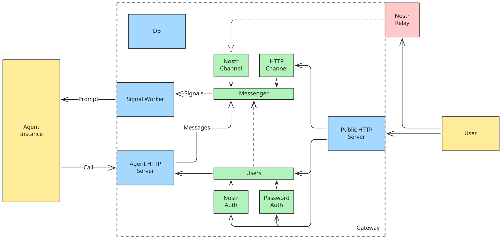

# Concorde

Concorde is a TypeScript library for building shared agents: AI agents that serve several
parties without giving any one party direct control. A trusted operator runs a gateway that
mediates interactions between users and the agent.

For example, two people could use one agent to coordinate a household budget. Each sends
messages through the gateway, and the agent can publish signed decisions that both can read.
The [shared-agent proposal](https://blog.shutter.network/on-shared-agents/) explains the idea.

The API is experimental. Version `0.1.0` may require application changes between releases.

## What you build

Your application chooses the components and defines how incoming signals become prompts.
Concorde supplies:

- Persistent message logs, with an HTTP channel or Nostr channel for delivery.
- Users and authentication through passwords or signed Nostr requests.
- A signal worker that executes runs one at a time.
- Schedules that wake the agent.
- Signed statements and stored, numbered decisions.

`createGateway` builds the database connection, HTTP servers, and signal worker. Your `extend`
callback constructs the optional components. Components expose `start()` and `stop()` methods;
the gateway manages their lifecycle.



The two channels in the diagram are alternatives: a messenger currently accepts one channel.
You run the agent instance separately. The included pi runtime connects to it over RPC; it does
not configure the model, credentials, tools, or container.

## Try it

You need Docker with Compose and a model provider credential. The minimal example uses Anthropic.

```sh
git clone https://github.com/shutter-network/concorde.git
cd concorde/examples/00_minimal
cp .env.example .env
```

Set `ANTHROPIC_API_KEY` and `USER_PASSWORD` in `.env`, then start the stack:

```sh
docker compose up -d --build
docker compose logs -f gateway
```

Copy the user id printed in the log and open the client in another terminal:

```sh
docker compose run --rm tui <user-id>
```

The [guide](https://shutter-network.github.io/concorde/guide) explains how to adapt this example.
Import library APIs from subpaths such as `@shutter-network/concorde/gateway`; the package root
exports no API. Your application also selects the `/schema` exports it needs and manages its
own database migrations.

## Examples

Each example is an independent npm application with a Compose stack. It installs Concorde
from the registry rather than this checkout.

| Example | Demonstrates |
| --- | --- |
| [Minimal](./examples/00_minimal/) | One user exchanging messages over HTTP |
| [Scheduler](./examples/01_scheduler/) | Scheduled runs without users or messaging |
| [Decisions](./examples/02_decisions/) | Two users and a shared record of signed decisions |
| [Nostr](./examples/03_nostr/) | Encrypted direct messages through a local relay |
| [Agent isolation](./examples/04_agent_isolation/) | Restricted agent networking and a model proxy that holds the credential |

## Deployment boundaries

All parties must trust the operator. The agent server and agent RPC listener are privileged,
unauthenticated endpoints; keep them on a private network. Configure agent permissions, TLS,
rate limiting, secret management, and backups for your application.

Concorde does not prevent prompt injection or enforce confidentiality between users. Use `quote`
to mark user message boundaries in prompts and reduce prompt injection risk. A valid
signature authenticates a statement under the signing identity, not the agent's behavior.
Read the [architecture](https://shutter-network.github.io/concorde/architecture) before deploying.

## Documentation

The documentation is published at <https://shutter-network.github.io/concorde/>.

- [Guide](https://shutter-network.github.io/concorde/guide): run and adapt an application.
- [Architecture](https://shutter-network.github.io/concorde/architecture): components, execution, and trust boundaries.
- [API reference](https://shutter-network.github.io/concorde/reference/): exports, HTTP routes, and database tables.

## Develop the library

```sh
mise install
npm ci
docker run -d --name concorde-pg -e POSTGRES_PASSWORD=postgres -p 5432:5432 postgres:17
npm run check
```

Tests use real PostgreSQL databases. `npm run check` runs type checking, the build, lint, and
tests. See [CLAUDE.md](./CLAUDE.md) for development conventions and additional checks.

## Release

```sh
npm version patch   # alternatively: minor, major, or prerelease --preid rc
git push --follow-tags
```

Commit or stash any changes before running `npm version`; it requires a clean working tree.
The command updates the version in `package.json`. Its `version` script copies that number to
`describedVersion` in `src/gateway/gateway.ts`. Both changes are included in a release commit
tagged `v<version>`.

Pushing the tag starts the [publishing workflow](./.github/workflows/publish.yml). The workflow
checks that the tag matches the version in `package.json` and that the tagged commit is on
`main`. It then runs the full CI workflow on that commit. Once CI passes, it publishes the
package to npm using trusted publishing with provenance. After publication, it creates a
GitHub release and deploys the documentation site.

For versions with a prerelease suffix, such as `0.2.0-rc.0`, the workflow uses the npm dist-tag
`next` instead of `latest`, marks the GitHub release as a prerelease, and skips site deployment.

A published version number cannot be reused, even after unpublishing. npm allows unpublishing
within 72 hours if no other packages in the registry depend on the package; after that,
[stricter conditions apply](https://docs.npmjs.com/policies/unpublish/). To retire a version after
that window, deprecate it with `npm deprecate` and release a new version.
